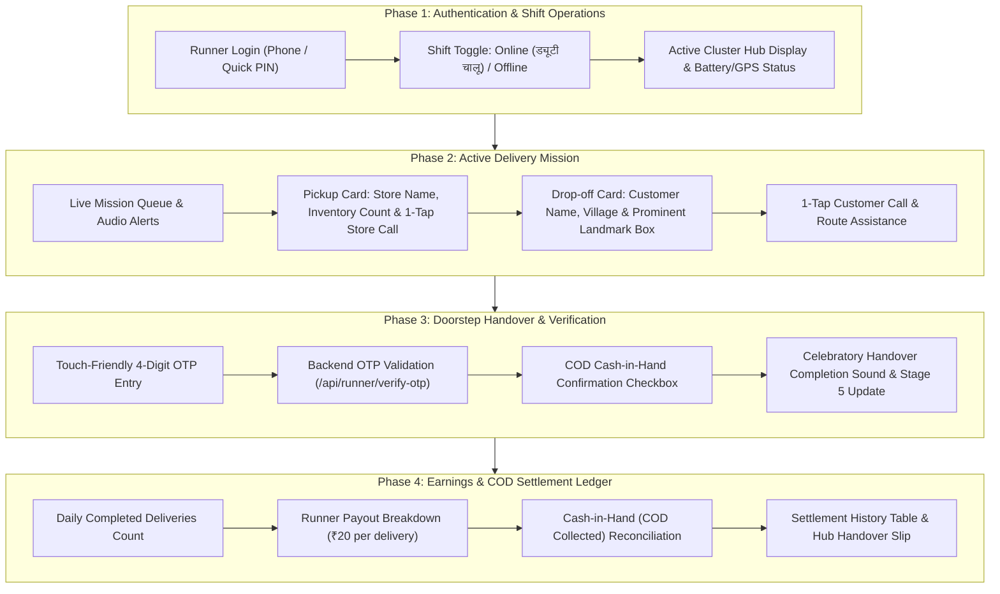

# GaonBazaar (गांव बाज़ार) - Gaon Mitra (गाँव मित्र) Delivery Partner App
## Comprehensive Product Blueprint & Technical Architecture Specification

---

## 1. Executive Summary & Persona Context

### 1.1 The Gaon Mitra (गाँव मित्र) Persona
**Gaon Mitra** represents the local rural youth runner operating within a cluster of 3 to 5 Gram Panchayats (typically within a 5 to 7 km operating radius). 

Unlike urban quick-commerce delivery drivers navigating street numbers, building names, and apartment buzzers, the Gaon Mitra navigates:
* Unpaved roads, canal banks (*patri*), and agricultural tracks.
* Houses identified by community landmarks (e.g., *"Shiva temple tube-well"*, *"Opposite blue Panchayat water tank"*, *"Near Khasra 42 banyan tree"*).
* Direct verbal coordination with shopkeepers and village elders.
* Mixed cash-on-delivery (COD) handoffs requiring physical cash reconciliation at the end of the shift.

### 1.2 Operating Constraints & Physical Environment
* **Extreme Outdoor Sunlight**: Requires high-contrast UI (contrast ratio > 7:1, WCAG AAA compliant), bold typography, and distinct color indicators.
* **Single-Handed Touch Operation**: Runners frequently operate on budget Android smartphones (360px to 412px viewports) with one hand while on bicycles or motorcycles. Minimum touch targets $\ge 48\text{px}-56\text{px}$.
* **Intermittent Network**: Connectivity fluctuates between village centers (4G/LTE) and remote farm dwellings (2G or zero signal). Offline resiliency and zero blocking calls are mandatory.
* **Bilingual Rural Literacy**: All interface elements must offer seamless one-tap switching between Hindi (*हिंदी*) and English, with intuitive visual iconography for every action.

---

## 2. Core Delivery Lifecycle & State Machine

The Gaon Mitra App connects directly to the existing GaonBazaar SQLite database (`backend/gaonbazar.db`) and coordinates with the Customer App (`index.html`) and Vendor Dashboard (`vendor_dashboard.html`) along the 5-stage timeline:

```mermaid
stateDiagram-v2
    direction LR
    s1: Stage 1 • Placed (Customer)
    s2: Stage 2 • Accepted (Vendor)
    s3: Stage 3 • Packed & Ready (Vendor)
    s4: Stage 4 • Out for Delivery (Gaon Mitra Pickup)
    s5: Stage 5 • Delivered (Doorstep OTP Handover)

    s1 --> s2: Vendor accepts order
    s2 --> s3: Vendor marks packed
    s3 --> s4: Gaon Mitra confirms pickup at store
    s4 --> s5: 4-Digit OTP verification & COD collection
```

| Lifecycle Stage | Customer View (`index.html`) | Vendor View (`vendor_dashboard.html`) | Gaon Mitra View (`runner_dashboard.html`) |
| :--- | :--- | :--- | :--- |
| **Stage 3: Packed** | "दुकानदार सामान पैक कर रहा है" | "रनर को सौंपें" (Waiting for Runner) | **New Pickup Mission Available** (`[पिकअप स्वीकारें]`) |
| **Stage 4: Out for Delivery** | "गाँव मित्र सामान लेकर निकल चुका है" | "ऑर्डर प्रस्थान कर चुका है" | **In-Transit to Landmark** (`[रास्ते में हैं]`) |
| **Stage 5: Delivered** | "ऑर्डर सफलतापूर्वक डिलीवर हुआ" | "डिलीवर हो गया" | **Mission Completed** (`+₹20.00 आय दर्ज`) |

---

## 3. UI/UX Architecture & Phase Breakdown

---

## 4. Phase-by-Phase Technical Specifications

### Phase 1: Runner Authentication & Shift Toggle (Online/Offline)
* **Runner Profile Entity**:
  * Name: Kamal Singh (कमल सिंह)
  * Runner Code: `#GM-RAMPUR-07`
  * Assigned Hub: Rampur Mandi Cluster Hub (Covering Rampur, Chaupal, Rampur South, and Khasra)
* **Shift State Management**:
  * **Online (`ड्यूटी चालू`)**: High-contrast vibrant emerald banner with pulsating live sync indicator. Actively listens to incoming Stage 3 / Stage 4 orders every 4 seconds.
  * **Offline (`ड्यूटी बंद`)**: High-contrast slate/amber banner. Mutes audio alerts, retains past ledger data.
* **Ergonomics & Touch**:
  * Massive $52\text{px}$ toggle switch with immediate tactile visual state.
  * Header displays quick cluster badge, audio alert volume toggle, and one-tap language switch (*हिंदी / English*).

### Phase 2: Active Delivery Mission Card (Pickup & Customer Landmark)
* **Store Pickup Section**:
  * Prominent Kirana Store Badge (e.g., *Sharma Brothers Kirana*).
  * Direct 1-tap Dukandaar Call button (`tel:...`) with native phone dialer integration.
  * Clear package summary: Item count, package weight, and order verification checklist.
  * **Action CTA**: `[दुकान से सामान उठाया • Confirm Store Pickup]` (Transition order from Stage 3 $\rightarrow$ Stage 4).
* **Customer Drop-off Section**:
  * Customer Name and Village Panchyat.
  * **Rural Landmark Spotlight Box**:
    * Rendered with bold yellow/amber high-contrast background and dark slate text (`#0f172a`).
    * Full landmark text (e.g., *"Near Shiva Mandir, Opp. Blue Water Tank, Khasra 42"*).
    * Landmark icon to draw runner's eye immediately.
  * Direct 1-tap Customer Call button (`tel:...`).
  * **Payment Badge Indicator**:
    * If COD: Bright amber badge with bold text: `💵 ₹358.00 नकद वसूल करें (Collect Cash)`.
    * If Online UPI: Emerald badge: `✅ ऑनलाइन भुगतान पूर्ण (₹0 Cash to Collect)`.

### Phase 3: Delivery Proof & Handover (4-Digit Doorstep OTP)
* **Doorstep OTP Verification**:
  * 4 individual large numeric touch boxes ($56\text{px} \times 64\text{px}$) with autofocus, auto-advance, and backspace handling.
  * Validation endpoint: `POST /api/runner/orders/{order_id}/verify-otp`.
  * Verifies against real `order.delivery_otp` stored securely in `backend/gaonbazar.db`.
* **COD Collection Checkbox**:
  * For COD orders, requires explicit tactile confirmation: `[✓] ग्राहक से ₹358.00 नकद प्राप्त कर लिया है`.
* **Handover Completion Feedback**:
  * Two-tone Web Audio API success chime.
  * Instant visual confirmation modal with order receipt ID, customer signature timestamp, and updated payout (+₹20.00).

### Phase 4: Daily Shift Earnings & Commission Summary
* **KPI Metrics Ribbon**:
  * **आज की डिलीवरी (Delivered Today)**: Total completed missions counter.
  * **कुल आय (Today's Earnings)**: Calculated as $\text{Deliveries} \times ₹20.00$ per trip incentive.
  * **रनर के पास नकद (COD in Hand)**: Running total of cash collected from customers, owed to the cluster hub/shopkeeper.
  * **कुल दूरी (Distance Covered)**: Aggregated estimated trip kilometers.
* **Settlement History Ledger**:
  * Detailed audit table listing each fulfilled order ID, customer landmark, payment mode, collected cash amount, and runner earnings.
  * "जमा रसीद (Generate Hub Deposit Slip)" modal to facilitate end-of-day cash reconciliation with the hub supervisor.

---

## 5. REST API Endpoints Specification (Backend)

The Gaon Mitra App utilizes dedicated endpoints in `backend/main.py` integrated with `backend/models.py`:

| Method | Endpoint | Description | Request / Query | Response DTO |
| :--- | :--- | :--- | :--- | :--- |
| `GET` | `/api/runner/profile` | Fetches active runner details, shift status, and hub assignment | `?runner_id=gm_1` | `RunnerProfileDTO` |
| `POST` | `/api/runner/shift` | Toggles runner shift status (`is_online: bool`) | `{ runner_id, is_online }` | `ShiftStatusResponse` |
| `GET` | `/api/runner/missions` | Retrieves active and ready pickup orders (Stages 3 & 4) | `?store_id=...` | `List[RunnerMissionDTO]` |
| `POST` | `/api/runner/orders/{order_id}/pickup` | Confirms pickup at store; advances order to Stage 4 | None | `RunnerMissionDTO` |
| `POST` | `/api/runner/orders/{order_id}/verify-otp` | Validates doorstep 4-digit OTP; advances order to Stage 5 | `{ otp: "4821", cod_collected: true }` | `HandoverResponse` |
| `GET` | `/api/runner/ledger` | Aggregates daily deliveries, earnings (₹20/order), and COD cash in hand | `?runner_id=gm_1` | `RunnerLedgerDTO` |

---

## 6. Implementation & Verification Checklist

- [ ] **Phase 1: Architecture & Backend Foundations**
  - [ ] Add Pydantic Schemas for Runner in `backend/schemas.py` (`RunnerProfileDTO`, `RunnerMissionDTO`, `VerifyOTPRequest`, `RunnerLedgerDTO`).
  - [ ] Add Runner API routes in `backend/main.py` (`/api/runner/missions`, `/api/runner/orders/...`).
  - [ ] Register static route `/runner` and `/runner_dashboard.html` in `backend/main.py`.

- [ ] **Phase 2: Mobile-First Frontend (`runner_dashboard.html`)**
  - [ ] Implement Tailwind high-contrast rural theme (emerald, amber, slate-900).
  - [ ] Implement Bilingual (Hindi/English) dictionary and dynamic switch.
  - [ ] Build Header with Shift Online/Offline Toggle and Hub Badge.
  - [ ] Build Mission Tabs:
    - Tab 1: Live Missions Queue (`सक्रिय मिशन`)
    - Tab 2: Pickup & Drop-off Navigation Card (`ऑर्डर विवरण व लैंडमार्क`)
    - Tab 3: Shift Earnings & COD Cash Ledger (`कमाई व बहीखाता`)
  - [ ] Implement Large 4-Box Doorstep OTP Input with auto-advance and error feedback.
  - [ ] Implement Web Audio API alert chimes for mission notifications and completion bells.

- [ ] **Phase 3: Integration & Navigation Shortcuts**
  - [ ] Add Gaon Mitra Runner Portal button in Customer App header (`index.html`).
  - [ ] Add Gaon Mitra Runner Portal button in Vendor Dashboard header (`vendor_dashboard.html`).

- [ ] **Phase 4: Automated E2E Playwright Test Suite (`test_runner_e2e.py`)**
  - [ ] Configure real rural budget smartphone profiles (Redmi 9A / Realme C35 viewports: 360px & 393px).
  - [ ] Test Shift Toggle (Online $\leftrightarrow$ Offline) with live state updates.
  - [ ] Test Pickup Mission Reception $\rightarrow$ Store Call bounds $\rightarrow$ Pickup Confirmation (Stage 3 $\rightarrow$ 4).
  - [ ] Test Rural Landmark Spotlight Box text rendering and Customer Call button bounds.
  - [ ] Test Doorstep 4-digit OTP Verification (Stage 4 $\rightarrow$ 5) with SQLite database persistence check.
  - [ ] Test COD Cash Collection tracking and ₹20/order commission ledger.
  - [ ] Visual screenshots captured per step and comprehensive report generation.
