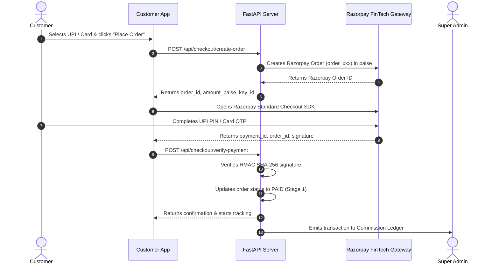

# GaonBazaar FinTech Economics & Payment Reconciliation Specification

**Document Version:** 2.5.0-fintech-audit  
**Target Financial Engine:** Backend Accounting Ledger (`backend/main.py`), Client Calculation Engines (`index.html`, `vendor_dashboard.html`, `runner_dashboard.html`, `admin_dashboard.html`)  
**Currency Standard:** Indian Rupees (INR) with 100% Integer-Paise Precision (`1 INR = 100 Paise`)  

---

## 1. Zero Fake Settlement Policy

In strict accordance with the owner's directive:
1. **No Simulated Success:** GaonBazaar never presents a simulated "Payment Successful" or "Bank Settled" dialog based on client-side timers or synthetic IDs.
2. **Authoritative Provider Verification:** 
   - Online payments require a cryptographically verified `razorpay_signature` generated by HMAC SHA-256 using the server's private secret.
   - Bank payouts are marked `pending_external_verification` until an authorized payment gateway / banking partner returns a confirmed UTR (Unique Transaction Reference).
   - In Sandbox / Test mode, transactions are explicitly tagged as `test_mode` or `sandbox` in the database and audit trail.

---

## 2. Integer-Paise Financial Mechanics & Zero Float Drift

All transactions, subtotals, taxes, delivery fees, and commissions are calculated using **integer paise** internally to eliminate floating-point rounding errors (such as `0.1 + 0.2 = 0.30000000000000004`):

$$\text{Amount in Paise} = \text{Round}(\text{Amount in INR} \times 100)$$

```python
# Server-side validation example from backend/main.py
item_total_paise = sum(item.price_paise * item.quantity for item in order.items)
delivery_fee_paise = calculate_delivery_tier_paise(distance_km)
platform_fee_paise = 300  # Flat ₹3.00 platform handling fee
total_payable_paise = item_total_paise + delivery_fee_paise + platform_fee_paise
```

---

## 3. Delivery Economics & Revenue Split Architecture

### 3.1 Distance-Based Delivery Charge Tiers (8 km Rural Service Radius)
The delivery fee is dynamically determined by server-side geocoding and routing distance:

| Distance Range | Customer Delivery Fee | Platform Share | Runner Commission | Guaranteed ETA |
|---|---|---|---|---|
| **0.0 – 2.0 km** | **₹15** (1,500 paise) | ₹10 (1,000 paise) | ₹5 (500 paise) | 20–30 Mins |
| **>2.0 – 4.0 km** | **₹20** (2,000 paise) | ₹10 (1,000 paise) | ₹10 (1,000 paise) | 30–45 Mins |
| **>4.0 – 5.0 km** | **₹25** (2,500 paise) | ₹10 (1,000 paise) | ₹15 (1,500 paise) | 40–50 Mins |
| **>5.0 – 8.0 km** | **₹35** (3,500 paise) | ₹10 (1,000 paise) | ₹25 (2,500 paise) | 45–60 Mins |
| **>8.0 km** | *Out of Service Radius* | N/A | N/A | Rejected at Checkout |

### 3.2 Platform Handling Fee
- A flat **₹3.00** (300 paise) platform maintenance fee is added to every customer order, funding rural server infrastructure, SMS dispatch, and map geocoding.

### 3.3 Vendor Settlement
- The Vendor receives **100% of the product subtotal** (gross items value) credited to their store ledger upon confirmed OTP delivery, minus any mutually agreed cooperative commission or returns.

---

## 4. Cash on Delivery (COD) Reconciliation & Deposit Slips

For rural households paying via physical cash:
1. **COD Order Placement:** Customer confirms order with `COD` payment method. No upfront payment required.
2. **Doorstep Cash Collection:** Upon arrival, the Runner collects the exact cash amount shown on the runner mission card (`Collect Cash from Customer: ₹...`).
3. **4-Digit OTP Gate:** The runner inputs the customer's 4-digit OTP. Only upon OTP verification does the order status transition to `Delivered`.
4. **Deposit Slip & Daily Settlement:** 
   - Cash collected accumulates in the runner's physical cash ledger.
   - At the end of the shift, the Runner App generates a digital **Cash Deposit Slip** with QR code and transaction breakdown.
   - Cash is deposited at the village Mandi Hub or deducted from the runner's weekly bank payout.

---

## 5. Razorpay FinTech Integration & Webhook Reconciliation


