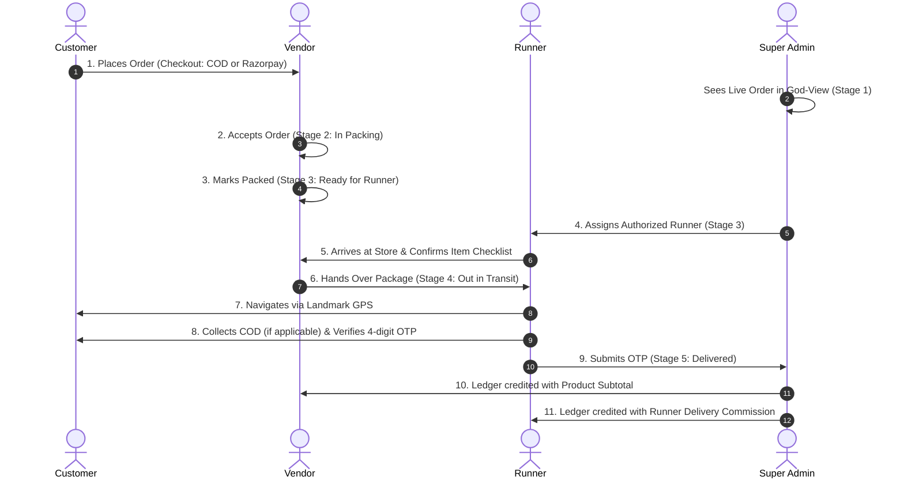

# GaonBazaar Super Admin KYC, Operations & Legal Compliance Specification

**Document Version:** 2.5.0-production-grade  
**Target Architecture:** Super Admin Operations Control Plane (`admin_dashboard.html`), FastAPI Backend (`backend/main.py`), Database Models (`backend/schemas.py`, `models.py`)  
**Security Level:** Enterprise Multi-Tenant FinTech & Identity Protection  

---

## 1. Authoritative Role & Architecture Overview

The Super Admin Control Plane is an existing **desktop and tablet-optimized web dashboard** (`admin_dashboard.html`) connected to all three mobile applications (Customer, Vendor, Runner). 

It is the authoritative operational control plane for:
1. Multi-role identity verification and onboarding governance (Vendor & Runner).
2. Live God-View order tracking and exception management.
3. FinTech reconciliation, commission ledger auditing, and provider-confirmed payout approvals.
4. Internal account risk management (cancellation strikes, COD blocking, blacklisting).
5. Unified Help Desk & Grievance Ticket resolution (`/api/admin/support/tickets`).

---

## 2. Status Model & Lifecycle Transitions

GaonBazaar enforces an authoritative, multi-state onboarding model persisted in SQLite/PostgreSQL:

```
[not_submitted] ──► [pending_approval] ──► [needs_more_info]
                            │                     │
                            ▼                     ▼
                        [approved] ◄────── [resubmitted]
                            │
                            ▼
                  [rejected / suspended]
```

### State Definitions:
- `not_submitted`: Entity registered phone number but has not completed basic business/identity KYC. Cannot fulfill orders or receive disbursements.
- `pending_approval`: Identity and banking details submitted. Locked behind the compliance review screen in the mobile app. Awaiting human administrator or provider review.
- `needs_more_info`: Administrator requested clarification (e.g., blurry shop signage, mismatch between name and bank account). Resubmission permitted without losing history.
- `approved`: Super Admin verified physical premises, masked identity proofs, and beneficiary bank match. Store can open (`is_open = True`) and runner can go on duty (`is_on_duty = True`).
- `rejected`: Application denied due to fraudulent identity, duplicate pan/GST, or bad actor record.
- `suspended`: Temporarily barred by risk management due to consecutive cancellations, counterfeit stock, or customer complaints.

---

## 3. Legal & Statutory KYC Compliance Framework

### 3.1 Aadhaar & Identity Verification Policy (Strict Compliance with Supreme Court & UIDAI Regulations)
1. **Voluntary & Consent-Based:** In accordance with UIDAI regulations and statutory guidelines, submission of Aadhaar is strictly voluntary and consent-based. Alternative government photo identities (Voter ID, Driving Licence, PAN Card, Passport) are offered as lawful primary options.
2. **Customer Protection:** Ordinary rural consumers purchasing groceries are **never subjected to mandatory Aadhaar verification**. A verified mobile phone number with SMS/WhatsApp OTP is the sole requirement for Customer account creation.
3. **Data Masking & Redaction:** 
   - Raw 12-digit Aadhaar numbers and biometric templates are **never stored** in GaonBazaar databases.
   - Any uploaded identity document references are masked (`•••• •••• 9988`) on all client viewports.
   - Identity photos are restricted to authenticated Super Admin operators under least-privilege role policies and encrypted at rest.
4. **UIDAI Verification Integrity:** No fake UIDAI responses or simulated scraping are used. Where live e-KYC is active, it routes through authorized AUA/KUA entities or uses digitally signed Offline Paperless XML/QR code validation.

### 3.2 Bank & UPI Beneficiary Verification
1. **No Simulated Success:** Payout accounts are marked `pending_external_verification` until an authorized financial provider (RazorpayX, Cashfree, or NPCI IMPS Penny Drop) confirms the account-holder name match.
2. **Masked Banking Display:** Bank account numbers are stored encrypted and displayed on all user and admin screens as masked strings (e.g., `••••••••1234`).
3. **Penny Drop Audit Log:** Super Admin audit records capture the exact `bank_ref_id`, `utr_number`, `beneficiary_name_match_score`, and timestamp.

### 3.3 Runner Vehicle & License Verification
1. **Contextual Document Requirement:** Runners operating on foot or bicycle are not required to provide driving licenses or vehicle RC books.
2. **Motorcycle / Scooter Partners:** Valid Driving License and Vehicle Registration Certificate (RC) are reviewed manually by Super Admin before assigning long-distance missions (>4 km).

---

## 4. End-to-End Operational Lifecycle Workflows



---

## 5. Help Desk & Grievance Tickets Integration (`#tab-tickets`)

The Super Admin dashboard connects directly to `/api/admin/support/tickets`:

### Capabilities:
- **Unified Grievance Queue:** Aggregates support inquiries raised by Customers (from AI Order Support, Help Center, or Complaint modal), Vendors, and Runners.
- **Filtering:** Instant toggle between `All`, `Open` (unresolved inquiries), `In Review`, and `Resolved`.
- **Real-Time Notification Dispatch:** When Super Admin enters resolution notes and clicks "Resolve Ticket" (`handleResolveTicket`), the backend:
  1. Updates the `SupportTicket` status to `resolved` and saves `resolution_notes`.
  2. Dispatches an in-app persistent notification (`Notification` model) to the ticket submitter.
  3. Updates the Super Admin navigation badge count (`#tab-tickets-badge`).

---

## 6. Role-Based Permissions & IDOR Defense

| Endpoint | Customer | Vendor | Runner | Super Admin |
|---|---|---|---|---|
| `GET /api/orders/{id}` | Own order only | Assigned store only | Assigned order only | All orders (God-View) |
| `POST /api/vendor/orders/{id}/quick-action` | Denied (403) | Own store only | Denied (403) | Allowed (Audit override) |
| `POST /api/runner/missions/{id}/action` | Denied (403) | Denied (403) | Assigned mission only | Allowed (Audit override) |
| `POST /api/runner/missions/{id}/verify-otp` | Denied (403) | Denied (403) | Assigned runner only | Denied (Delivery integrity) |
| `GET /api/admin/*` | Denied (403) | Denied (403) | Denied (403) | Authorized Super Admin |
| `POST /api/admin/support/tickets/{id}/action` | Denied (403) | Denied (403) | Denied (403) | Authorized Super Admin |
