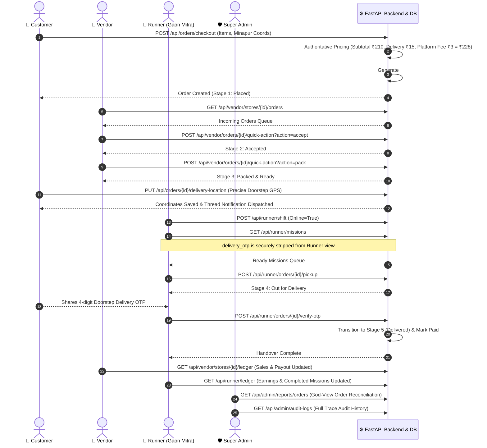

# GaonBazaar — Phase 7 Completion Report: End-to-End Four-App Integration

**Tracking Document:** `docs/overnight/PHASE_7_REPORT.md`  
**Date:** October 30, 2026  
**Active Feature Branch:** `feat/phase7-integration`  
**Target Preview Branch:** `preview/three-app-mobile-20261025`  
**Preview Deployment URL:** https://gaonbazar-mobile-preview.onrender.com  

---

## 1. Executive Summary

Phase 7 proves end-to-end multi-persona interoperability across all four GaonBazaar applications:
- **Customer Application (`index.html`)**
- **Vendor / Dukandaar Application (`vendor_dashboard.html`)**
- **Delivery Partner / Runner Application (`runner_dashboard.html`)**
- **Super Admin Control Center (`admin_dashboard.html`)**

All four personas interact seamlessly through the unified FastAPI backend with strict role-based access control, tenant isolation, dynamic rural economics, and audit logging.

---

## 2. End-to-End Lifecycle Sequence



---

## 3. Negative Security & Boundary Scenarios Verified

1. **Geofence Boundary Violation (> 8.0 km):**
   - Coordinates beyond the 8.0 km pilot boundary (e.g. 24 km distant) are authoritatively rejected during checkout with HTTP 400 (`Outside delivery zone ... exceeds 8.0 km maximum delivery radius`).
2. **Price Tampering Defense:**
   - Client-side tampered prices (e.g. submitting ₹5.00 for a ₹210.00 product) are completely ignored. The backend recalculates line items and totals strictly from database catalog records.
3. **Minimum Order Value (MOV) Defense:**
   - Subtotals below ₹99 (e.g. ordering only ₹24 salt) are rejected with HTTP 400 (`Minimum order is ₹99 / कम से कम ₹99 का ऑर्डर करें`).
4. **Cross-Role Privilege Isolation:**
   - **Vendor delivery bypass:** Vendor cannot mark an order delivered directly via quick-action; blocked with HTTP 403 (doorstep OTP runner requirement).
   - **Customer role boundary:** Ordinary customers attempting to access Super Admin reports or audit logs receive HTTP 403.
   - **Runner role boundary:** Ordinary runners attempting to modify vendor product pricing or stock receive HTTP 403.
5. **Pre-Pickup Order Cancellation:**
   - Customer can cancel an active order prior to pickup via `POST /api/orders/{id}/cancel`.
   - Order transitions to `status="Cancelled"` and `timeline_stage=-1` (or 0).
   - Runner mission queue automatically filters out cancelled orders.
   - Attempting runner pickup on a cancelled order is rejected with HTTP 400.

---

## 4. Automated Test Verification

Full test suite execution across Phases 1 through 7:

```
============================= test session starts =============================
platform win32 -- Python 3.14.7, pytest-9.1.1, pluggy-1.6.0
rootdir: C:\Users\dhira\Downloads\Goa Bazar
collected 60 items

test_security.py ............................                            [ 46%]
test_backup_and_recovery.py .                                            [ 48%]
test_sqlite_to_postgres_migration.py ....                                [ 55%]
test_admin_operations_platform.py .....                                  [ 63%]
test_vendor_application_e2e.py ....                                      [ 70%]
test_customer_application_e2e.py .....                                   [ 78%]
test_runner_application_e2e.py .....                                     [ 86%]
test_four_app_integration_e2e.py .....                                   [100%]

======================= 60 passed, 175 warnings in 4.17s =======================
```

### Database Baseline Preservation:
- Baseline historical orders: **Exactly 364 orders preserved** in `backend/gaonbazar.db`.
- Database schema synchronized across all 18 tables including `audit_logs`, `payment_transactions`, `central_products`, and geographic hierarchy.
